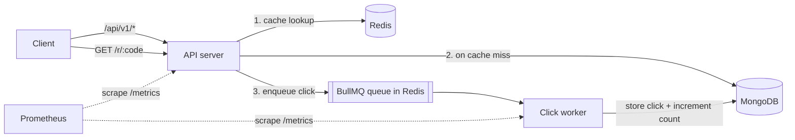

# LinkSnap

A URL shortener with click analytics, built to be run and operated like a production service: caching, rate limiting, background processing, health checks, metrics and graceful shutdown.

**Stack:** Node.js · TypeScript · Express 5 · MongoDB (Mongoose) · Redis (ioredis) · BullMQ · Zod · Pino · Prometheus (prom-client)

---

## Architecture



**Redirect flow (`GET /r/:code`)**
1. Look up `code → url` in Redis (cache-aside).
2. On a miss, read from MongoDB and cache it with a TTL.
3. Push a click event to the queue **without waiting**, and redirect the user immediately.
4. The worker saves the click and increments the link's counter in the background.

---

## Features

- **Auth:** register and login with bcrypt-hashed passwords and JWT tokens
- **Links:** create, list (paginated), delete, and per-link stats (clicks per day for the last 7 days)
- **Redis cache** for redirects, invalidated when a link is deleted
- **Redis rate limiting**, shared across all API instances (auth: 10/min, link creation: 30/min per IP)
- **Background worker** for click tracking, with retries and exponential backoff
- **Idempotent processing:** a retried job never counts the same click twice
- **Resilience:** if Redis is down or unresponsive, redirects fall back to MongoDB within about 500ms
- **Observability:** structured JSON logs, Prometheus metrics, liveness and readiness probes
- **Graceful shutdown** on SIGTERM for both the API and the worker

---

## Getting started

### Prerequisites
- Node.js 24+
- Docker (for MongoDB and Redis)

### Run locally

```bash
# 1. Start MongoDB and Redis
docker run -d --name linksnap-mongo -p 27017:27017 mongo:7
docker run -d --name linksnap-redis -p 6379:6379 redis:7-alpine

# 2. Install dependencies and configure the environment
npm install
cp .env.example .env    # then set JWT_SECRET to a random value

# 3. Start the API and the worker (two terminals)
npm run dev             # API on http://localhost:3000
npm run dev:worker      # worker, health/metrics on http://localhost:9100
```

### Production build

```bash
npm run build
npm start               # API
npm run start:worker    # worker
```

### Scripts

| Script | What it does |
|---|---|
| `npm run dev` | API with auto-reload (tsx) |
| `npm run dev:worker` | Worker with auto-reload |
| `npm run build` | Compile TypeScript to `dist/` |
| `npm start` | Run the compiled API |
| `npm run start:worker` | Run the compiled worker |

---

## Environment variables

| Variable | Default (dev) | Description |
|---|---|---|
| `NODE_ENV` | `development` | In `production`, `MONGO_URI`, `REDIS_URL` and `JWT_SECRET` are required |
| `SERVER_PORT` | `3000` | API port |
| `API_BASE_URL` | `/api/v1` | Prefix for API routes |
| `PUBLIC_BASE_URL` | `http://localhost:3000` | Used to build `shortUrl` in responses |
| `MONGO_URI` | `mongodb://localhost:27017/linksnap` | MongoDB connection string |
| `REDIS_URL` | `redis://localhost:6379` | Redis connection string |
| `JWT_SECRET` | dev-only default | Secret used to sign JWTs |
| `JWT_EXPIRES_IN` | `7d` | Token lifetime |
| `LINK_CACHE_TTL_SECONDS` | `3600` | How long redirects stay cached |
| `WORKER_PORT` | `9100` | Worker health/metrics port |
| `WORKER_CONCURRENCY` | `10` | Jobs processed in parallel per worker |
| `LOG_LEVEL` | `info` | Pino log level |
| `TRUST_PROXY` | `0` | Number of proxies in front of the app (set to `1` behind a load balancer) |

---

## API

All API routes are under `/api/v1`. Protected routes need `Authorization: Bearer <token>`.

### Auth

| Method | Route | Auth | Body | Response |
|---|---|---|---|---|
| POST | `/auth/register` | – | `{ email, password }` (password ≥ 8 chars) | `201 { token, user }` |
| POST | `/auth/login` | – | `{ email, password }` | `200 { token, user }` |
| GET | `/auth/me` | ✓ | – | `200 { id, email, createdAt }` |

### Links

| Method | Route | Auth | Body / Query | Response |
|---|---|---|---|---|
| POST | `/links` | ✓ | `{ url }` (http/https only) | `201 { code, url, shortUrl, clicks, createdAt }` |
| GET | `/links` | ✓ | `?page=1&limit=20` | `200 { links, page, limit, total }` |
| DELETE | `/links/:code` | ✓ | – | `204` |
| GET | `/links/:code/stats` | ✓ | – | `200 { code, url, totalClicks, daily: [{ date, clicks }] }` |

### Redirect and operations

| Method | Route | Description |
|---|---|---|
| GET | `/r/:code` | `302` redirect to the original URL, `404` if not found |
| GET | `/healthz` | Liveness: the process is up |
| GET | `/readyz` | Readiness: `200` if MongoDB is connected, `503` otherwise. Also reports Redis status |
| GET | `/metrics` | Prometheus metrics |

The worker exposes `/healthz`, `/readyz` and `/metrics` on `WORKER_PORT`.

### Errors

| Status | When |
|---|---|
| `400` | Validation failed (`{ message, errors: [{ field, message }] }`) or invalid JSON |
| `401` | Missing/invalid token, or wrong email/password |
| `404` | Link or route not found |
| `409` | Email already registered |
| `429` | Rate limit exceeded (includes a `Retry-After` header) |

### Example

```bash
# Register
curl -X POST localhost:3000/api/v1/auth/register \
  -H 'content-type: application/json' \
  -d '{"email":"me@example.com","password":"supersecret"}'

# Create a link
curl -X POST localhost:3000/api/v1/links \
  -H "Authorization: Bearer $TOKEN" -H 'content-type: application/json' \
  -d '{"url":"https://example.com"}'

# Follow it
curl -i localhost:3000/r/<code>
```

---

## Metrics

| Metric | Type | Description |
|---|---|---|
| `http_request_duration_seconds` | Histogram | Request latency by method, route and status |
| `linksnap_redirects_total` | Counter | Redirects by `cache="hit"` / `"miss"` |
| `linksnap_worker_jobs_total` | Counter | Worker jobs by `status="completed"` / `"failed"` |

Default Node.js process metrics (CPU, memory, event loop lag, GC) are also exposed.

---

## Design decisions

- **Clicks are recorded asynchronously.** The redirect only does a cache read and a queue push, so it stays fast even under heavy traffic. The worker can be scaled separately from the API, based on queue length.
- **Idempotent worker.** Each click is upserted by its BullMQ job id (unique index), and the counter is only incremented when a new click is inserted. Retries can't double count.
- **The cache fails open.** The cache client has no offline queue and a 500ms command timeout. When Redis is down or slow, it's treated as a cache miss and MongoDB serves the request.
- **The rate limiter fails open.** If Redis is unavailable, requests are allowed rather than blocking every user.
- **Readiness doesn't depend on Redis.** The app works without Redis, so a Redis outage shouldn't pull every instance out of the load balancer. MongoDB is required, so readiness fails without it.
- **Liveness checks no dependencies.** A database blip shouldn't make the orchestrator restart healthy processes.
- **Metrics are labelled by route pattern** (`/r/:code`), not the actual path, to keep the number of time series small.
- **Configuration is environment-only** (12-factor). Production refuses to start without its secrets.

### Known tradeoffs
- If Redis is down when a link is deleted, its cached URL keeps redirecting until the TTL expires.
- If the worker crashes between inserting a click and incrementing the counter, that one increment is lost. The `clicks` collection remains the source of truth.
- Clicks made while Redis is fully down can't be queued, so they aren't counted. Redirects still work.

---

## Project structure

```
src/
├── app.ts               # Express app: middleware, routes, error handling
├── server.ts            # API entry point: DB connection, listen, graceful shutdown
├── worker.ts            # Worker entry point: processes click jobs, health/metrics server
├── config/
│   ├── environment.ts   # All env vars in one place
│   ├── database.ts      # MongoDB connect/disconnect/ready check
│   ├── redis.ts         # Cache client + BullMQ connection factory
│   └── logger.ts        # Pino logger
├── routers/             # Routes only: path → middleware → validation → controller
├── validations/         # Zod schemas for body, params and query
├── controllers/         # Read the request, call a service, send the response
├── services/            # Business logic (no req/res), shared by the API and the worker
├── models/              # User, Link, Click (Mongoose)
├── middlewares/         # requireAuth, rateLimit
├── queues/              # Click queue (created lazily)
├── utils/               # HttpError, metrics, validate()
└── types/               # Express Request type extension
```

**Request flow:** `router → middlewares → validate() → controller → service → model`

---

## Roadmap

- [ ] React frontend
- [ ] Tests and CI with GitHub Actions
- [ ] Dockerfiles and docker-compose
- [ ] AWS infrastructure with Terraform (ECS Fargate, ALB, S3/CloudFront)
- [ ] Kubernetes with Helm, HPA and KEDA queue-based autoscaling
- [ ] Prometheus + Grafana dashboards and alerts, k6 load tests
