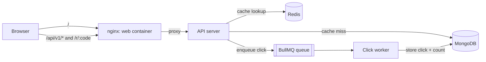

# LinkSnap

A URL shortener with click analytics: create short links, share them, and see how many people clicked and when.

| Folder | What it is |
|---|---|
| [`api/`](api) | Node.js + TypeScript backend: REST API, Redis caching and rate limiting, BullMQ click worker, health checks and Prometheus metrics |
| [`web/`](web) | React + TypeScript frontend, served by nginx in Docker |
| [`docker-compose.yml`](docker-compose.yml) | Runs the API, worker and web together |

## Architecture



- **nginx** serves the built React app and proxies `/api` and `/r` to the API, so the browser talks to a single origin and the API is not exposed directly.
- The **API and worker use the same image** with different commands (`dist/server.js` and `dist/worker.js`).
- MongoDB and Redis are external (e.g. MongoDB Atlas and Redis Cloud), configured through `api/.env`.

See [`api/README.md`](api/README.md) for the API reference, design decisions and tradeoffs.

## Run with Docker

Requires Docker, plus a MongoDB and a Redis you can connect to.

```bash
cp api/.env.example api/.env   # set MONGO_URI, REDIS_URL and JWT_SECRET
docker compose up --build
```

Open http://localhost:8080.

| Service | What it runs | Exposed |
|---|---|---|
| `web` | nginx with the React build | `localhost:8080` |
| `api` | Express API (`dist/server.js`) | internal only, via nginx |
| `worker` | BullMQ click worker (`dist/worker.js`) | internal only |

Compose overrides a few values from `api/.env` for Docker: `NODE_ENV=production`, `TRUST_PROXY=1` (nginx sits in front of the API) and `PUBLIC_BASE_URL=http://localhost:8080` (short links point to nginx).

The Redis used for the queue should have its eviction policy set to `noeviction`, so queued clicks are never evicted.

```bash
docker compose ps              # api and worker should be "healthy"
docker compose logs -f api     # follow logs
docker compose down            # stop everything
```

## Run without Docker (development)

```bash
# API (terminal 1)
cd api && npm install && cp .env.example .env && npm run dev

# Worker (terminal 2)
cd api && npm run dev:worker

# Web (terminal 3)
cd web && npm install && cp .env.example .env && npm run dev
```

Open http://localhost:5173. The Vite dev server proxies `/api` and `/r` to the API on port 3000.
