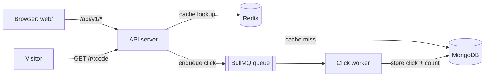

# LinkSnap

A URL shortener with click analytics: create short links, share them, and see how many people clicked and when.

| Folder | What it is |
|---|---|
| [`api/`](api) | Node.js + TypeScript backend: REST API, Redis caching and rate limiting, BullMQ click worker, health checks and Prometheus metrics |
| [`web/`](web) | React + TypeScript frontend |

## Architecture



See [`api/README.md`](api/README.md) for the API reference, design decisions and tradeoffs.

## Run locally

```bash
# MongoDB + Redis
docker run -d --name linksnap-mongo -p 27017:27017 mongo:7
docker run -d --name linksnap-redis -p 6379:6379 redis:7-alpine

# API (terminal 1)
cd api && npm install && cp .env.example .env && npm run dev

# Worker (terminal 2)
cd api && npm run dev:worker

# Web (terminal 3)
cd web && npm install && cp .env.example .env && npm run dev
```

Open http://localhost:5173.
